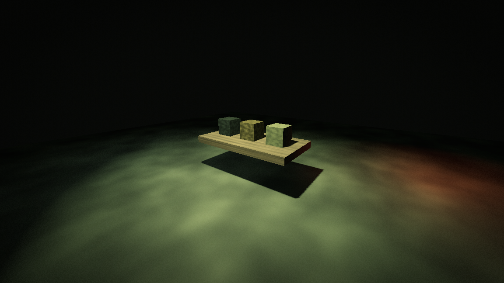

# visual/ — 可复用画面风格模块

把「后处理管线」和「风格」分开：游戏只依赖管线和一份外观 Profile，换风格不用改场景结构。



## 先看效果

打开 `demo/demo.tscn` 按 **F6** 运行：`1/2/3` 切换 low / balanced / high，`Space` 开关后处理，
`H` 隐藏提示。预览图是本机 Godot 4.7 的实际渲染截图，不是示意图。

## 结构

```text
visual/
├── README.md                 本文件
├── demo/                     可 F6 运行的演示场景（demo.tscn / demo.gd）
├── core/                     通用管线，与题材无关
│   ├── style_profile.gd      外观参数 + shader 引用（Resource）
│   ├── post_process.gd       CanvasLayer 后处理组件
│   ├── post_process.tscn
│   └── style_stage.tscn      可选：低分辨率 3D 视口容器
└── styles/
    └── industrial/           工业复古：暗角、颗粒、有限色阶、双区调色
        ├── shaders/          单采样 / 三采样色差 + 公共函数
        ├── presets/          low / balanced / high
        ├── materials/        5 种材质与贴图
        ├── lights.tscn       灯光预设
        ├── environment.tres
        ├── industrial.tscn   开箱即用后处理（已绑 balanced 预设）
        └── preview.png       实测预览图
```

## 用法 A：保留场景，只加后处理

1. 把 `styles/industrial/industrial.tscn` 拖进主场景，实例化一次。
2. 在 Inspector 的 `Profile` 里换预设或调参数。
3. 需要清晰的 HUD 放独立 CanvasLayer，`layer` 设为 100（效果层默认 20）。

只加后处理**不会**减少 3D 渲染成本，它增加一次屏幕复制和一次全屏绘制。

## 用法 B：同时降低 3D 分辨率

1. 实例化 `core/style_stage.tscn`。
2. 把 3D 世界放到 `WorldViewport/Content` 下；相机、灯光、WorldEnvironment 都放这里，并启用相机的 Current。
3. 给 `WorldViewport/PostProcess` 指定 Profile（比如 industrial 的 balanced）。
4. UI 放在 Stage 外的 CanvasLayer，保持原生分辨率。
5. 调 Stage 的 `stretch_shrink`：1 = 原生，2 = 1/4 像素量，3 ≈ 1/9。

Stage 使用独立 World3D：鼠标拾取、屏幕投影要基于 WorldViewport，不能再用根窗口。

## 新增一个风格

1. 在 `styles/` 下建目录，放 shader 和默认预设。
2. 预设的 `shader` 字段指基础 shader；有三采样版本就同时指 `chromatic_shader`。
3. **组件不用改**，它只读 Profile。

通用参数见 `core/style_profile.gd`。项目自定义外观请另存 Profile 副本，不要直接改随包预设。

## 验证

`tests/test_visual_style.gd` 覆盖：无 Profile 不绘制、参数同步、色差切换、开关停复制、
同视口查重、全部资源可加载、`industrial.tscn` 开箱即用、demo 按键切换。
headless 只验证逻辑与资源，**不能用来评价 GPU 画面或性能**；画面效果请在编辑器里
打开 `demo/demo.tscn` 按 **F6** 实测。

灯光与材质预设按演示房间尺寸设计，换场景后要按实际尺寸和题材调整，没有通用固定数值。
